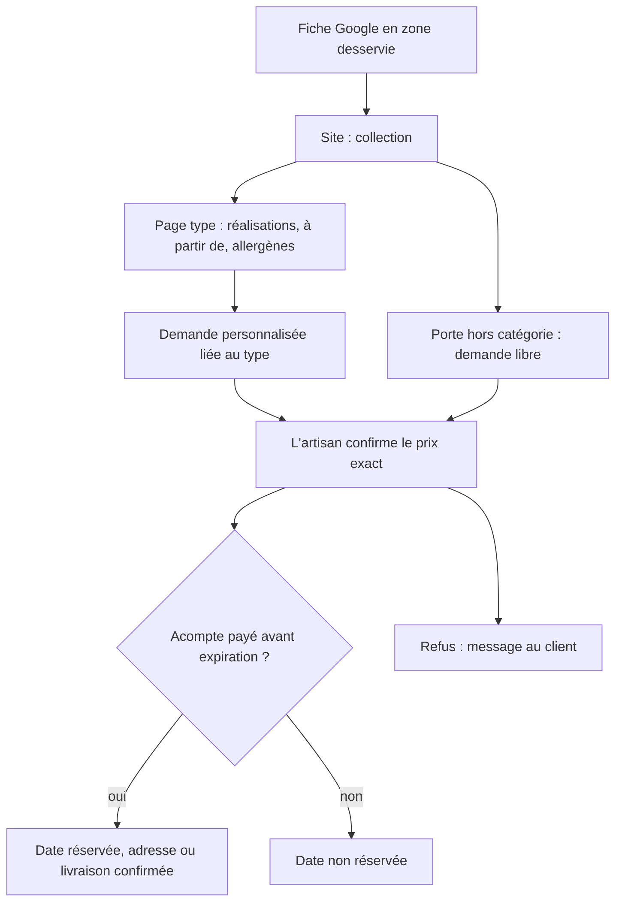
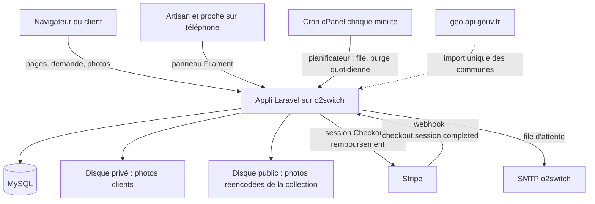
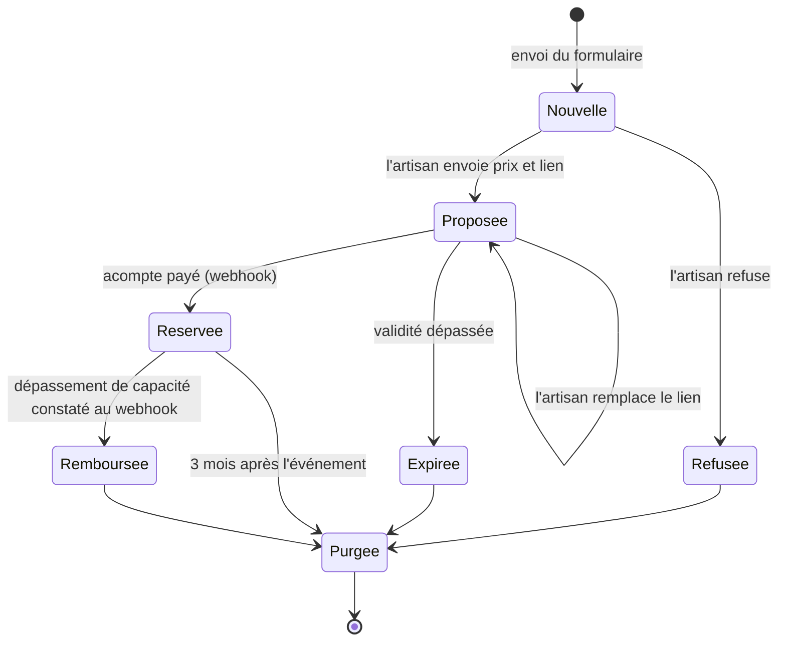
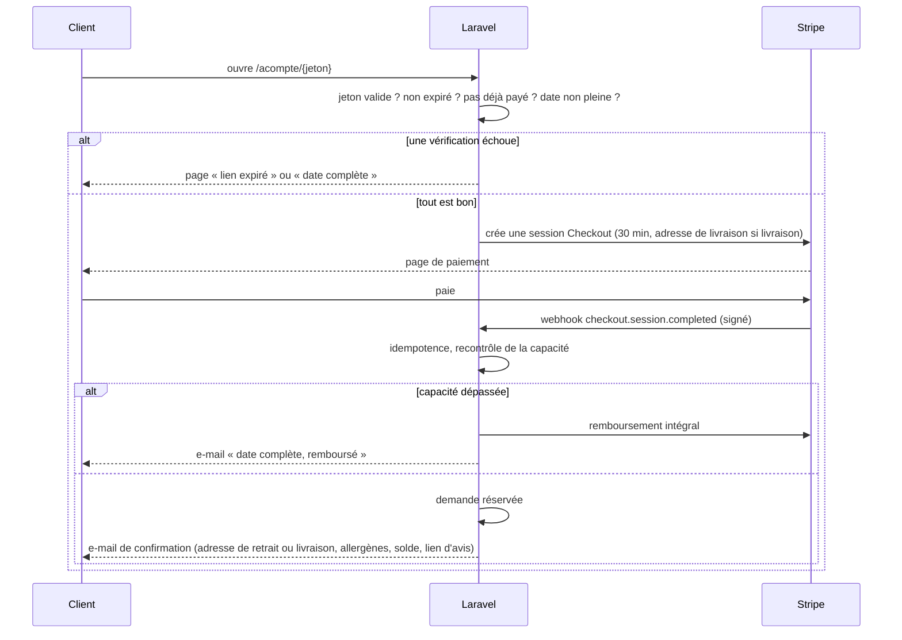
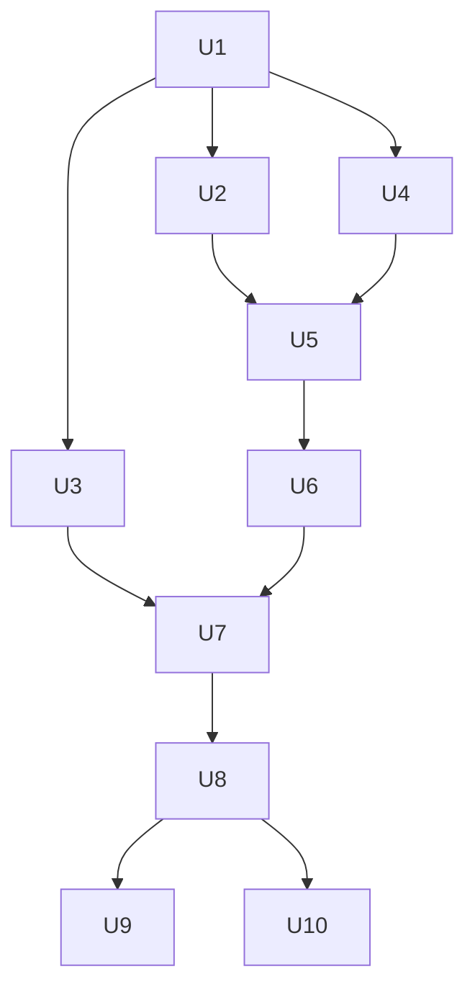

# Collection-vitrine trouvable - Plan

## Goal Capsule

- **Objectif :** des personnes qui ne connaissent pas l'artisan le trouvent en ligne, voient ce qu'il fait et à partir de quel prix, et lui envoient une demande de gâteau complète qui se conclut par un acompte.
- **Moyen :** une fiche Google Business Profile en zone desservie qui mène vers une application Laravel hébergée chez o2switch : collection de types de gâteaux, formulaires de demande, espace atelier privé pour répondre, acompte payé par Stripe via un lien à durée choisie (KTD1, KTD4).
- **Autorité produit :** ce document ; les décisions marquées `session-settled` ont été prises avec le porteur du projet (un proche de l'artisan). Le Product Contract l'emporte sur le comportement ; les KTD l'emportent sur le mécanisme ; une unité ne contredit ni l'un ni l'autre.
- **Blocages ouverts :** aucun pour l'implémentation. Deux blocages de mise en ligne : l'adresse professionnelle des textes légaux (Outstanding Questions) et le contenu fourni par l'artisan (types, photos, prix, allergènes, taux d'acompte, conditions d'annulation, paliers de livraison).
- **Conditions d'arrêt :** arrêter et demander si une exigence R ne peut être tenue sur l'hébergement mutualisé o2switch, si Stripe ne permet plus une session payable une seule fois avec expiration, ou si une unité exige de publier l'adresse du domicile.
- **Profil d'exécution :** application neuve dans ce dépôt, tests Pest à chaque unité, répétition complète F1 → F3 en mode test Stripe avant la mise en ligne.
- **Qui termine :** le proche de l'artisan finit, déploie et met en ligne ; l'artisan fournit le contenu et crée la fiche Google avec le guide de U10.

---

## Product Contract

### Summary

Une fiche Google et un site vitrine font connaître un artisan pâtissier de Dammartin-en-Goële au-delà du bouche-à-oreille.
Le site présente une collection de types de gâteaux d'anniversaire (number cake, layer cake, gâteau à thème, fraisier…), chacun sur sa page avec des exemples de réalisations, un prix « à partir de » et une demande qui recueille la personnalisation voulue.
L'artisan confirme le prix exact de chaque demande et envoie un lien d'acompte ; une demande libre couvre ce qui n'entre dans aucun type.

Le tout tient dans une seule application Laravel sur l'hébergement o2switch existant.
L'artisan gère la collection et répond aux demandes depuis un espace atelier privé utilisable sur téléphone ; le site émet ses propres liens d'acompte, qui ouvrent un paiement Stripe tant qu'ils sont valides et que la date n'est pas pleine.
La fiche Google et le lien d'avis relèvent d'un guide d'exploitation, pas du code.

### Problem Frame

L'artisan travaille seul, depuis chez lui, surtout sur des gâteaux d'anniversaire.
Ses commandes arrivent par téléphone et par le bouche-à-oreille, rarement par Instagram : il n'est visible que pour les gens qui le connaissent déjà ou qui connaissent un de ses clients.

Quand une commande arrive, elle demande environ cinq échanges : prise de contact, besoins du client, proposition avec prix, puis négociation de la livraison.
Il recalcule le prix à chaque commande, car il dépend du nombre de parts, du type de gâteau et des ingrédients.
La plupart des commandes sont personnalisées : forme, photo, inscription.
Il ne demande pas d'acompte aujourd'hui et souhaite en mettre un en place.

Sa priorité est de recevoir des commandes de personnes qui ne le connaissaient pas.
Réduire les échanges et sécuriser l'acompte viennent ensuite.

### Actors

- A1. Visiteur ou client : particulier d'Île-de-France ou de l'Oise qui cherche un gâteau d'anniversaire et ne connaît pas l'artisan.
- A2. Artisan : pâtissier seul, travaille chez lui, reçoit les demandes, fixe le prix final et prépare les gâteaux.

### Key Decisions

- **Prix « à partir de » sur chaque type de gâteau.** Le prix final varie avec les parts, le type de gâteau, les ingrédients et la personnalisation. (session-settled: user-directed — chosen over prix ferme par formule, prix de base plus options affichées, ou simple fourchette : le prix final dépend de trop de paramètres pour être figé.) Governs R3.
- **Le prix final est confirmé par l'artisan, pas calculé par le site.** Un seul aller-retour remplace les cinq échanges actuels, sans obliger l'artisan à écrire une grille de prix. (session-settled: user-approved — chosen over calcul automatique du total par le site : pas de règles de prix à figer.) Governs R12.
- **La visibilité passe avant l'optimisation des commandes.** La collection sert d'abord à être trouvé ; la demande structurée et l'acompte suivent. (session-settled: user-approved — chosen over un focus sur la réception des demandes avec la visibilité traitée à part : se faire connaître au-delà du bouche-à-oreille est la priorité de l'artisan.)
- **Découverte par la fiche Google, conversion sur le site.** Pour une recherche locale, Google montre la carte et les fiches avant les sites ; un artisan sans boutique ni historique en ligne y gagne le plus vite. (session-settled: user-approved — chosen over un site seul organisé par gâteau, ou par occasion : c'est le chemin le plus court vers des clients inconnus.) Governs R1, R2.
- **Zone desservie : Île-de-France et Oise.** (session-settled: user-directed — chosen over Dammartin et communes proches, ou nord Seine-et-Marne élargi : l'artisan veut couvrir toute la région.) Governs R1, R16.
- **La collection est faite de types de gâteaux personnalisables, pas de gâteaux figés.** La plupart des commandes sont personnalisées (forme, photo, inscription) ; chaque type sert de point de départ et montre des réalisations passées. (session-settled: user-directed — chosen over une collection de gâteaux à composition fixe, issue de l'idéation : elle ne correspond pas à la réalité des commandes.) Governs R2, R3, R6, R7.
- **Une porte secondaire pour le hors-catégorie.** Les personnalisations courantes passent par les pages de type ; la demande libre ne sert qu'à ce qui n'entre dans aucun type. (session-settled: user-approved — chosen over supprimer la demande libre, ou un formulaire unique sans pages de type.) Governs R9.
- **Les demandes de dernière minute sont acceptées sous réserve.** L'artisan tranche au cas par cas plutôt que de perdre la demande. (session-settled: user-approved — chosen over bloquer les dates trop proches, ou appliquer un supplément urgence.) Governs R10.
- **Retrait gratuit, livraison facturée par zones affichées.** Le client connaît le coût de livraison dès sa demande. (session-settled: user-approved — chosen over livraison fixée au cas par cas, ou retrait uniquement : la zone est trop large pour négocier chaque livraison.) Governs R16.
- **L'adresse de l'artisan n'est jamais publique.** Il travaille chez lui. (session-settled: user-approved — chosen over adresse publique, ou point de retrait neutre : protège le domicile tout en gardant le retrait sur place.) Governs R1, R4, R15.
- **Acompte à la confirmation.** L'artisan veut sécuriser les commandes, en particulier celles de clients qu'il ne connaît pas. Governs R13, R14.
- **Le solde est payé à la remise du gâteau.** (session-settled: user-directed — chosen over un second lien de paiement avant l'événement : aucun second paiement à suivre.) Governs R21.
- **Capacité par jour, vérifiée au paiement.** Un paiement est refusé quand la date est déjà pleine, plutôt que remboursé après coup. (session-settled: user-directed — chosen over une simple information dans l'atelier avec remboursement manuel, ou un lien ouvert qui bloque la date : pas de remboursement à gérer, pas de date bloquée par un client silencieux.) Governs R20.
- **Les données des demandes sont supprimées 3 mois après l'événement.** (session-settled: user-directed — chosen over 1 mois ou 1 an : laisse le temps d'une réclamation sans garder longtemps des données de santé.) Governs R19, R23.
- **L'adresse professionnelle des textes légaux reste à choisir.** Les mentions légales et les CGV exigent une adresse géographique, ce qui heurte la décision de ne jamais publier le domicile. (session-settled: user-directed — chosen over une domiciliation décidée maintenant, ou l'adresse du domicile dans les seuls textes légaux : l'artisan tranchera avant la mise en ligne.) Governs R22.

### Requirements

**Être trouvé**

- R1. Une fiche Google Business Profile existe en zone desservie (Île-de-France et Oise), sans adresse publique, avec photos, types de gâteaux et le lien vers le site mis en avant ; le numéro de téléphone de l'artisan y reste affiché.
- R2. Le site présente une collection de types de gâteaux d'anniversaire choisis par l'artisan (par exemple number cake, layer cake, gâteau à thème, fraisier), chacun sur sa propre page.
- R3. Chaque page de type montre des exemples de réalisations personnalisées, un prix « à partir de », les formats en nombre de parts, ce qui peut être personnalisé (forme, photo, inscription, couleurs), le délai minimum de commande et un bouton de demande.
- R4. Le site nomme Dammartin-en-Goële et la zone desservie dans son texte, sans jamais afficher l'adresse de l'artisan ; les photos publiées sur le site et la fiche Google ne contiennent aucune donnée de localisation et ne montrent ni façade ni rue.
- R5. Au lancement de la fiche Google, l'artisan envoie le lien d'avis Google à ses clients existants, et ce lien figure dans chaque confirmation de commande.

**Demander un gâteau**

- R6. Le bouton de demande d'une page de type ouvre une demande déjà liée à ce type ; le client y indique parts, personnalisation voulue, date, retrait ou livraison (avec commune), allergies des convives et coordonnées.
- R7. Le client peut joindre à sa demande la photo à reproduire sur le gâteau et des photos d'inspiration.
- R8. Toute demande pose la question obligatoire « Comment avez-vous connu l'artisan ? ».
- R9. Une porte secondaire permet une demande libre pour ce qui n'entre dans aucun type de la collection, avec description, date, nombre de parts et photos facultatives.
- R10. Une demande pour une date plus proche que le délai minimum de l'artisan reste possible, avec un avertissement indiquant que l'artisan confirmera s'il peut la prendre.
- R11. À l'envoi, le client reçoit un accusé qui récapitule sa demande et précise que l'artisan confirmera le prix exact.

**Confirmer et réserver**

- R12. L'artisan répond à chaque demande avec le prix exact, livraison comprise, sans calcul automatique par le site.
- R13. La réponse de l'artisan contient un lien de paiement en ligne de l'acompte, valable pendant une durée fixée par l'artisan et affichée dans la réponse ; la date n'est réservée qu'une fois l'acompte payé, et un lien expiré ne permet plus de payer.
- R14. Le taux d'acompte et les conditions d'annulation sont fixés par l'artisan et affichés avant l'envoi d'une demande.
- R15. L'adresse de retrait n'est communiquée qu'au client dont l'acompte est payé.
- R16. Le retrait est gratuit ; les zones de livraison et leur tarif sont affichés sur le site avant la demande, la commune saisie affiche le tarif de sa zone, et une commune hors zone desservie ne propose que le retrait.

**Conformité**

- R17. Chaque page de type indique les allergènes de sa recette de base parmi les 14 du règlement INCO, avec la mention que la personnalisation peut en ajouter ; la réponse de l'artisan et la confirmation envoyée au client indiquent les allergènes du gâteau réellement commandé, y compris pour une demande hors catégorie.
- R18. Les mentions légales et les conditions générales de vente (acompte, annulation, livraison) sont accessibles avant l'envoi d'une demande.
- R19. Une politique de confidentialité est accessible avant l'envoi d'une demande ; les coordonnées, allergies et photos transmises ne sont accessibles qu'à l'artisan (et à son proche s'il gère le site), servent uniquement à traiter la commande et sont supprimées 3 mois après la date de l'événement (3 mois après la dernière activité pour une demande refusée ou jamais payée).
- R22. Les mentions légales et les CGV indiquent l'adresse professionnelle choisie par l'artisan, qui n'est jamais son domicile affiché ailleurs sur le site ; tant que cette adresse et les conditions de vente ne sont pas renseignées, le site n'accepte aucune demande.
- R23. Le client donne un consentement explicite au traitement des allergies qu'il déclare avant de pouvoir envoyer une demande qui en contient.

**Capacité et solde**

- R20. L'artisan fixe un nombre maximal de gâteaux par jour, ajustable pour une date précise ; un client ne peut pas payer un acompte pour une date déjà pleine et reçoit un message qui le lui dit.
- R21. Les CGV et la confirmation de commande indiquent que le solde se paie à la remise du gâteau.

### Key Flows

- F1. Un inconnu trouve l'artisan et demande un gâteau personnalisé à partir d'un type
  - **Trigger :** A1 cherche un gâteau d'anniversaire sur Google et tombe sur la fiche de l'artisan.
  - **Actors :** A1, A2
  - **Steps :** A1 ouvre le site depuis la fiche, parcourt la collection, ouvre la page d'un type de gâteau, voit des réalisations, le prix « à partir de » et les allergènes, clique sur le bouton de demande, décrit sa personnalisation et joint sa photo si besoin, complète parts, date, mode de retrait ou livraison, allergies et « comment avez-vous connu l'artisan », puis envoie.
  - **Outcome :** A1 reçoit un accusé ; A2 reçoit une demande complète liée au type choisi.
  - **Covered by :** R1, R2, R3, R6, R7, R8, R11, R17

- F2. Un client demande une création hors catégorie
  - **Trigger :** A1 ne trouve aucun type qui correspond à son projet.
  - **Actors :** A1, A2
  - **Steps :** A1 passe par la porte secondaire, décrit son projet, ajoute éventuellement des photos d'inspiration et envoie.
  - **Outcome :** même suite que F1 à partir de la confirmation (F3).
  - **Covered by :** R8, R9, R11

- F3. L'artisan confirme et le client réserve
  - **Trigger :** A2 reçoit une demande (F1 ou F2).
  - **Actors :** A2, A1
  - **Steps :** A2 fixe le prix exact, livraison comprise, et envoie sa réponse avec le lien d'acompte et les allergènes du gâteau commandé ; A1 paie l'acompte avant l'expiration du lien ; la date est réservée ; A1 reçoit l'adresse de retrait ou la confirmation de livraison.
  - **Refus :** si A2 ne peut pas prendre la commande (date pleine, délai trop court, demande hors de ses possibilités), il répond par un refus et A1 reçoit un message le lui indiquant.
  - **Outcome :** une commande réservée avec acompte, ou un refus clair, sans négociation au cas par cas.
  - **Covered by :** R10, R12, R13, R14, R15, R16, R17, R20, R21



### Acceptance Examples

- AE1. Covers R13, R15.
  - **Given :** une demande confirmée par l'artisan avec un lien d'acompte.
  - **When :** le client ne paie pas l'acompte.
  - **Then :** la date n'est pas réservée et le client n'a jamais reçu l'adresse de l'artisan.
- AE2. Covers R6, R16.
  - **Given :** un client de l'Oise qui choisit la livraison.
  - **When :** il remplit sa demande en indiquant sa commune.
  - **Then :** il a vu le tarif de sa zone de livraison avant d'envoyer, et le prix confirmé par l'artisan l'inclut.
- AE3. Covers R4, R1.
  - **Given :** un visiteur qui consulte le site ou la fiche Google.
  - **When :** il cherche où se trouve l'artisan.
  - **Then :** il voit « Dammartin-en-Goële » et la zone desservie, jamais une adresse de rue.
- AE4. Covers R10.
  - **Given :** un délai minimum de commande affiché sur la page d'un type.
  - **When :** un client choisit une date plus proche que ce délai.
  - **Then :** il peut envoyer sa demande, après avoir vu un avertissement indiquant que l'artisan confirmera s'il peut la prendre.
- AE5. Covers R20.
  - **Given :** une capacité d'un gâteau le samedi 14, et deux clients ayant chacun reçu un lien d'acompte valide pour ce jour.
  - **When :** le premier paie, puis le second clique sur son lien.
  - **Then :** le second voit que la date est complète et ne peut pas payer ; l'artisan voit ce lien comme bloqué par la capacité.
- AE6. Covers R13.
  - **Given :** un lien d'acompte dont la validité est dépassée.
  - **When :** le client l'ouvre.
  - **Then :** il voit que le lien a expiré et aucune page de paiement ne s'ouvre.

### Success Criteria

- L'artisan reçoit chaque mois des commandes de personnes qui ne le connaissaient pas, comptées grâce à la réponse à R8, aux statistiques de la fiche Google (appels, clics vers le site) et à la même question posée par l'artisan quand un inconnu l'appelle.
- Une demande à partir d'un type se conclut en une réponse de l'artisan plus un paiement d'acompte, au lieu d'environ cinq échanges.

### Scope Boundaries

**Deferred for later**

- Les « pièces à adopter » : créations de saison en nombre limité, proposées par l'artisan.
- Des pages par occasion (anniversaire enfant, adulte, baptême…), une fois qu'il y aura assez de photos et d'avis.
- La collecte structurée de photos et d'avis clients sur le site après l'événement (les avis Google sont couverts par R5).
- Un calendrier public des disponibilités.

**Outside this product's identity**

- Le calcul automatique du prix et la commande payée en totalité en ligne : le prix final reste une décision de l'artisan.
- Une boutique en ligne de produits standard expédiés.

### Dependencies / Assumptions

- L'activité de l'artisan est déclarée pour vendre des gâteaux produits à domicile (statut, immatriculation, déclaration sanitaire) ; le site ne remplace pas ces démarches.
- L'artisan fournit la liste des types de gâteaux, des photos de réalisations passées pour chacun, leurs prix « à partir de », leurs allergènes, le taux d'acompte, les conditions d'annulation et les zones de livraison avec tarifs.
- L'objectif chiffré de commandes mensuelles venant d'inconnus (par exemple 3 à 5) est une hypothèse à valider avec l'artisan.
- Google réserve l'adresse masquée aux entreprises qui se déplacent chez leurs clients : dès la création de la fiche, vérifier qu'elle est acceptée en zone desservie avec retrait sur place, présenter la livraison comme mode principal et préparer la vérification demandée par Google (souvent une vidéo).
- Une fiche Google en zone desservie est plus visible près de Dammartin que dans le reste de l'Île-de-France et de l'Oise ; la zone large reste servie, mais la découverte sera surtout locale au départ.

### Outstanding Questions

**Resolve Before Launch**

- Quelle adresse professionnelle figure dans les mentions légales, les CGV et le profil Stripe : domiciliation commerciale ou adresse du domicile limitée aux textes légaux ? L'application la lit dans un réglage et reste fermée aux demandes tant qu'elle est vide (R22, KTD10).
- Contenu à fournir par l'artisan : types de gâteaux, photos de réalisations, prix « à partir de », formats en parts, allergènes de base, délai minimum par type, taux d'acompte, conditions d'annulation, paliers de livraison, capacité par jour, lien d'avis Google.

**Deferred to Implementation**

- Versions exactes de Laravel et Filament compatibles avec la version de PHP choisie sur o2switch (PHP 8.5 disponible, modifiable) : à fixer à l'installation.
- Prise en charge du format HEIC par la bibliothèque d'images installée chez o2switch (Imagick ou GD) : détermine si les photos d'iPhone sont réencodées ou conservées telles quelles (KTD7).

### Product Contract preservation

Changed : R19 précisée (durée fixée à 3 mois) ; R20 à R23 ajoutées à partir des décisions de session (capacité, solde, adresse légale, consentement allergies) ; AE5 et AE6 ajoutés. Aucune exigence existante affaiblie ; les trois questions « Deferred to Planning » sont tranchées par KTD1, KTD3 et KTD4.

### Sources / Research

- Idéation d'origine, idée « Deux portes : la collection et le sur-mesure » : fichier temporaire hors dépôt, non versionné.
- Règlement INCO (UE 1169/2011) et décret 2015-447 : information écrite obligatoire sur les 14 allergènes, y compris pour la vente à emporter et la livraison.
- Pratique documentée chez les pâtissiers : politique d'acompte annoncée avant la demande pour filtrer les demandes non sérieuses.
- Stripe, création d'une Checkout Session : `expires_at` entre 30 minutes et 24 heures ; une session expirée ne peut plus être payée (https://docs.stripe.com/api/checkout/sessions/create). Fonde KTD4.
- Stripe Payment Links : pas d'expiration dans le temps, désactivation manuelle ou par API seulement. Écarté par KTD4.
- Mollie Payment Links : `expiresAt` natif, mais le comportement après expiration n'est pas documenté (https://docs.mollie.com/reference/create-payment-link). Écarté par KTD4.
- Netlify Forms : 8 Mo maximum par envoi, inadapté à plusieurs photos. A pesé contre un hébergement statique avec formulaires hébergés.
- Code de la consommation, art. L221-28 3° : pas de droit de rétractation pour un bien confectionné selon les spécifications du consommateur ; à mentionner dans les CGV (U10). Non vérifié sur la source primaire.
- geo.api.gouv.fr : liste officielle des communes avec coordonnées, source de l'import de U4.

---

## Planning Contract

### Key Technical Decisions

- KTD1. **Une seule application Laravel rend le site, les formulaires, l'atelier et le paiement.** Pages rendues côté serveur (Blade), MySQL, un seul déploiement. L'artisan voit ses modifications en ligne immédiatement, sans reconstruction ni compte GitHub. (session-settled: user-directed — chosen over un site statique Astro avec Sveltia CMS plus une petite appli PHP, ou WordPress avec extensions : un seul outil pour l'artisan, et le lien d'acompte comme l'atelier exigent de toute façon du code sur mesure.) Governs R2, R3, R6–R16.
- KTD2. **Hébergement sur l'abonnement o2switch existant (cPanel).** PHP natif, MySQL, cron, SSH et Git ; serveurs en France, ce qui garde les allergies et les photos sur le territoire (R19). Node.js est disponible mais sert seulement à compiler les assets, pas à exécuter l'application. (session-settled: user-directed — chosen over Cloudflare, Netlify avec stockage S3 séparé, ou un VPS : abonnement déjà payé et maîtrisé.)
- KTD3. **L'atelier est un panneau Filament réservé à deux comptes : l'artisan et le proche.** Connexion par mot de passe plus un code reçu par e-mail. Le panneau gère la collection, les réglages, les paliers de livraison, la capacité et les demandes, et reste utilisable sur téléphone. Aucune inscription publique. (session-settled: user-directed — chosen over une réponse par e-mail avec un petit outil de lien, ou un lien Stripe manuel sans expiration : tout est tracé et les dates pleines sont visibles.) Governs R12, R13, R20.
- KTD4. **Le site émet ses propres liens d'acompte, et chaque clic crée une session Stripe Checkout de courte durée.** Le lien `/acompte/{jeton}` porte le montant, la durée choisie par l'artisan et l'état. À l'ouverture, l'application vérifie l'expiration, le fait qu'aucun paiement n'ait déjà eu lieu et la capacité (KTD5), puis crée une session Checkout qui expire au bout de 30 minutes, limitée au paiement par carte (Apple Pay et Google Pay compris). Une session encore ouverte pour le même lien est réutilisée plutôt que doublée, et une nouvelle proposition ou un refus expire par l'API Stripe la session ouverte de l'ancien lien. Seul le webhook `checkout.session.completed`, avec signature vérifiée et `payment_status` à « paid », marque l'acompte payé ; la page de retour ne fait qu'afficher. Le webhook ne réserve que si le lien est encore actif et sans paiement, et si la demande est « Proposée » ; sinon il rembourse intégralement comme en KTD5, n'envoie aucune confirmation (donc aucune adresse de retrait) et prévient l'artisan. Une session ouverte avant l'expiration du lien reste payable pendant ses 30 minutes : c'est la seule tolérance, et elle est volontaire. Le jeton est aléatoire, et seule son empreinte est stockée. Choisi plutôt que les Payment Links de Stripe (sans expiration dans le temps) et Mollie (comportement après expiration non documenté). Governs R13, R15.
- KTD5. **La capacité se vérifie deux fois : à la création de la session et à la réception du paiement.** Une date est pleine quand le nombre d'acomptes payés atteint la capacité du jour (valeur par défaut, ou valeur propre à cette date). Si deux clients paient presque en même temps et que le webhook constate un dépassement, l'application rembourse automatiquement le second paiement via l'API Stripe et prévient le client et l'artisan. Le recomptage et la réservation se font dans une seule transaction, sous un verrou par date (ligne de capacité du jour verrouillée en écriture), et l'identifiant de session Stripe est unique dans la table des paiements : deux webhooks simultanés ne peuvent pas réserver tous les deux. Ce remboursement passe le test de 3.8 : il touche à l'argent et personne ne le verrait à temps. Governs R20.
- KTD6. **Zones de livraison par paliers de distance à vol d'oiseau depuis Dammartin-en-Goële, sur une table de communes importée une fois.** Une commande artisan importe depuis geo.api.gouv.fr les communes de Paris, des Hauts-de-Seine, de la Seine-Saint-Denis, du Val-de-Marne, de la Seine-et-Marne, des Yvelines, de l'Essonne, du Val-d'Oise et de l'Oise, et stocke pour chacune la distance au centre de Dammartin. Le palier se calcule à la volée à partir des paliers réglés dans l'atelier. Une commune au-delà du dernier palier, ou absente de la table, ne propose que le retrait. Pas d'appel d'API géographique pendant la saisie du client. (session-settled: user-directed — chosen over un tarif par département ou une liste de communes par zone : simple à régler, équitable dans un département étendu comme le 77.) Governs R16.
- KTD7. **Toute image est réencodée à l'import, ce qui retire les métadonnées EXIF et GPS.** Les photos de la collection, publiques, sont réduites et réencodées avec Intervention Image ; aucun fichier image n'est servi sans être passé par ce traitement (R4). Les photos des clients vont sur un disque privé hors du dossier public, réencodées quand le format le permet, et ne sont servies qu'aux comptes de l'atelier. Limites : 5 fichiers de 10 Mo au plus, JPEG, PNG, WebP ou HEIC. Un HEIC que le serveur ne sait pas décoder est gardé tel quel en privé : il n'est jamais publié et il est supprimé avec la demande. Governs R4, R7, R19.
- KTD8. **Les e-mails partent par SMTP o2switch depuis une adresse du domaine, via une file d'attente en base de données.** Le cron cPanel lance le planificateur Laravel chaque minute, qui vide la file. Une demande est donc enregistrée même si l'envoi échoue, et l'envoi est retenté. SPF, DKIM et DMARC sont configurés (U10). L'e-mail de notification à l'artisan ne contient ni allergies ni photos, seulement un lien vers l'atelier : sa boîte mail ne devient pas une copie des données de santé (R19).
- KTD9. **Une tâche planifiée quotidienne purge les demandes échues.** Elle supprime la demande, ses fichiers, ses liens d'acompte et les données personnelles de ses paiements, y compris l'adresse de livraison recopiée depuis Stripe, selon R19, et conserve une ligne anonyme (type, source, commune, montant, payé ou non, mois) pour les statistiques de succès. Governs R19.
- KTD10. **Les textes légaux et les conditions de vente sont des réglages de l'atelier, et une garde ferme les formulaires tant qu'un réglage obligatoire est vide.** Réglages obligatoires : adresse professionnelle, SIRET, taux d'acompte, conditions d'annulation, durée de validité des liens par défaut. La garde passe le test de 3.8 : sans elle, le site pourrait prendre des commandes sans CGV, et personne ne le verrait. L'adresse de retrait est un réglage chiffré, qui n'apparaît que dans l'e-mail de confirmation après paiement. Governs R14, R15, R18, R22.
- KTD11. **Pas de captcha au lancement : un champ piège et une limite de débit par adresse IP sur l'envoi des demandes.** Le volume attendu est faible, et un captcha tiers ajoute un prestataire et un bandeau de consentement.
- KTD12. **Le référencement repose sur des pages rendues côté serveur avec des données structurées `Bakery` qui portent `areaServed` et jamais `streetAddress`**, plus un `sitemap.xml` et des balises titre et description par type. Governs R2, R4.

### High-Level Technical Design

Composants et flux de données :



Cycle de vie d'une demande :



Paiement de l'acompte (KTD4, KTD5) :



### Output Structure

Structure Laravel standard ; les chemins ci-dessous sont ceux que ce plan ajoute ou façonne.

```text
app/
  Enums/                  Allergen (14 INCO), RequestStatus, Fulfilment, Source
  Models/                 CakeType, CakeTypePhoto, CakeRequest, RequestPhoto, DepositLink,
                          Payment, Commune, DeliveryTier, CapacityOverride, RequestStat, User
  Settings/               ShopSettings (réglages de l'atelier)
  Services/               DeliveryZoneResolver, CapacityGuard, ImageSanitizer, DepositCheckout
  Http/Controllers/       Collection, CakeRequest, Deposit, StripeWebhook, CommuneSearch
  Filament/Resources/     CakeType, CakeRequest, DeliveryTier, CapacityOverride + page Réglages
  Mail/                   RequestReceived, NewRequestForArtisan, DepositOffer, RequestDeclined,
                          OrderConfirmed, DepositRefunded
  Console/Commands/       ImportCommunes, PurgeExpiredRequests
resources/views/          pages publiques, formulaires, pages légales, e-mails
routes/web.php            pages publiques, demande, acompte, webhook
tests/Feature/, tests/Unit/
docs/operations/          guide fiche Google, DNS e-mail, Stripe, déploiement o2switch, check-list
```

### Assumptions

- L'accusé de réception annonce une réponse de l'artisan sous 48 heures ; l'application ne relance pas automatiquement.
- Une demande correspond à un seul gâteau ; plusieurs gâteaux pour un même événement font plusieurs demandes.
- L'adresse de livraison exacte est saisie au paiement, sur la page Stripe ; le créneau de retrait ou de livraison est proposé par l'artisan dans sa réponse.
- Les demandes libres utilisent un délai minimum global réglé dans l'atelier, et leurs allergènes ne sont donnés que dans la réponse de l'artisan (R17).
- Un type sans photo de réalisation n'est pas publié.
- Stripe est le seul prestataire de paiement, au tarif standard des cartes européennes ; l'artisan ouvre le compte en son nom.
- Une modification ou une annulation après acompte se traite par échange d'e-mails selon les CGV ; l'application n'a pas de parcours dédié.

### Risks & Dependencies

| Risque ou dépendance | Décision |
|---|---|
| L'hébergement mutualisé o2switch limite les processus longs : pas de worker de file permanent | Géré par KTD8 : le planificateur lancé par le cron vide la file chaque minute. Un e-mail peut donc partir avec jusqu'à une minute de retard, ce qui est accepté. |
| Extensions et limites PHP d'o2switch (Imagick ou GD, sodium, intl ; taille des envois, mémoire) non vérifiées | Vérification dans U1, avant U2 ; le choix de la version de PHP dans cPanel active les extensions nécessaires. HEIC traité par KTD7. |
| Le webhook Stripe doit atteindre le site en HTTPS, et un webhook manqué laisserait un acompte payé sans réservation | Stripe relance les webhooks non acquittés pendant plusieurs jours, et U8 est idempotent. La check-list de U10 vérifie la livraison des webhooks dans le tableau de bord Stripe. |
| Des e-mails classés en spam rendraient l'accusé, la proposition et la confirmation invisibles | SPF, DKIM et DMARC configurés dans U10 ; délivrabilité vérifiée dans Gmail et Outlook (Verification Contract). |
| Google peut refuser ou suspendre une fiche en zone desservie tenue depuis un domicile | Hors code : `docs/operations/fiche-google.md` prépare la vérification vidéo et présente la livraison comme mode principal. La fiche est lancée tôt, en parallèle du développement. |
| Filament et Laravel évoluent vite, et la double authentification par code e-mail dépend de la version de Filament | Versions fixées à l'installation (Outstanding Questions, Deferred to Implementation). Si la version retenue n'a pas de code e-mail intégré, un code à usage unique envoyé par e-mail est ajouté dans U3. |
| L'exception au droit de rétractation (L221-28 3°) n'a pas été vérifiée sur la source primaire | À vérifier en rédigeant les CGV dans U10 ; relecture des textes légaux par l'artisan avant la mise en ligne. |

### Sequencing

U1 pose le socle. U2, U3 et U4 peuvent avancer en parallèle. U5 et U6 construisent la demande. U7 dépend de la demande, et U8 dépend de U7. U9 et U10 viennent en dernier ; le guide de U10 peut commencer dès le début pour lancer tôt la vérification de la fiche Google, qui prend du temps.



---

## Implementation Units

| U-ID | Titre | Fichiers principaux | Dépend de |
|---|---|---|---|
| U1 | Socle Laravel, réglages et déploiement o2switch | `composer.json`, `app/Settings/ShopSettings.php`, `docs/operations/deploiement-o2switch.md` | — |
| U2 | Collection publique et pages de type | `app/Models/CakeType.php`, `app/Services/ImageSanitizer.php`, `resources/views/collection/` | U1 |
| U3 | Atelier Filament : collection et réglages | `app/Filament/Resources/CakeTypeResource.php`, `app/Filament/Pages/Settings.php` | U1 |
| U4 | Communes et paliers de livraison | `app/Console/Commands/ImportCommunes.php`, `app/Services/DeliveryZoneResolver.php` | U1 |
| U5 | Formulaires de demande | `app/Http/Controllers/CakeRequestController.php`, `resources/views/demande/` | U2, U4 |
| U6 | Enregistrement des demandes et e-mails d'accusé | `app/Models/CakeRequest.php`, `app/Mail/RequestReceived.php` | U5 |
| U7 | Atelier : traitement des demandes | `app/Filament/Resources/CakeRequestResource.php`, `app/Services/CapacityGuard.php` | U3, U6 |
| U8 | Acompte Stripe et confirmation | `app/Services/DepositCheckout.php`, `app/Http/Controllers/StripeWebhookController.php` | U7 |
| U9 | Purge planifiée et statistiques anonymes | `app/Console/Commands/PurgeExpiredRequests.php` | U8 |
| U10 | Pages légales et guides d'exploitation | `resources/views/legal/`, `docs/operations/` | U8 |

### U1. Socle Laravel, reglages et deploiement o2switch

**Goal :** une application Laravel vide mais déployable sur o2switch, avec ses réglages, sa garde de lancement et sa mise en page publique.

**Requirements :** R18, R22 ; KTD1, KTD2, KTD8, KTD10.

**Dependencies :** aucune.

**Files :**
- `composer.json`, `package.json`, `.env.example`
- `app/Settings/ShopSettings.php` (réglages persistés en base)
- `app/Http/Middleware/EnsureShopIsOpen.php`
- `resources/views/layouts/public.blade.php`
- `routes/console.php` (planificateur : file d'attente chaque minute)
- `docs/operations/deploiement-o2switch.md`
- `tests/Feature/ShopOpenGuardTest.php`

**Approach :**
1. Créer l'application Laravel dans ce dépôt avec Pest, en ciblant la version de PHP réglée sur o2switch.
2. Définir les réglages : adresse professionnelle, SIRET, nom commercial, taux d'acompte, conditions d'annulation, validité par défaut des liens, capacité par défaut, délai minimum des demandes libres, adresse de retrait (chiffrée), lien d'avis Google, e-mail de notification.
3. Brancher la garde KTD10 sur les routes des formulaires : réglage obligatoire vide, formulaire remplacé par un message « commandes bientôt ouvertes ».
4. Configurer la file d'attente en base et le planificateur ; documenter la ligne cron cPanel.
5. Documenter le déploiement : racine web vers `public/`, `git pull`, dépendances Composer sans dev, compilation des assets avec Node, migrations, mise en cache. Préciser l'autorisation de l'IP pour SSH chez o2switch.
6. Régler dans le sélecteur PHP de cPanel les limites nécessaires aux photos de KTD7 : `upload_max_filesize` au moins 10M, `post_max_size` au moins 60M, `max_file_uploads` au moins 5, `memory_limit` d'au moins 512M, `max_execution_time` d'au moins 60 s. Les vérifier sur le serveur.

**Patterns to follow :** conventions Laravel par défaut ; aucun code existant dans le dépôt.

**Test scenarios :**
- Adresse professionnelle vide : GET de la page de demande affiche le message de fermeture, et un POST de demande est refusé.
- Tous les réglages obligatoires remplis : la page de demande affiche le formulaire.
- L'adresse de retrait enregistrée est chiffrée en base : la valeur brute stockée ne contient pas le texte saisi.

**Verification :** l'application répond sur le domaine o2switch en HTTPS, le cron vide la file, et la garde ferme les formulaires sur une base vierge.

### U2. Collection publique et pages de type

**Goal :** l'accueil, la collection et une page par type publié, sans aucune adresse ni métadonnée de localisation.

**Requirements :** R2, R3, R4, R17 (partie page), R14 (affichage) ; F1 ; AE3 ; KTD7, KTD12.

**Dependencies :** U1.

**Files :**
- `database/migrations/*_create_cake_types_table.php`, `*_create_cake_type_photos_table.php`
- `app/Models/CakeType.php`, `app/Models/CakeTypePhoto.php`, `app/Enums/Allergen.php`
- `app/Services/ImageSanitizer.php`
- `app/Http/Controllers/CollectionController.php`
- `resources/views/home.blade.php`, `resources/views/collection/index.blade.php`, `resources/views/collection/show.blade.php`
- `resources/views/partials/structured-data.blade.php`, route `sitemap.xml`
- `tests/Feature/CollectionPagesTest.php`, `tests/Unit/ImageSanitizerTest.php`

**Approach :**
- Un type porte : nom, slug, description, prix « à partir de », formats en parts, éléments personnalisables, délai minimum en jours, allergènes de base (sous-ensemble des 14), ordre, publié ou non. Il est visible seulement s'il est publié et a au moins une photo (voir Assumptions).
- `ImageSanitizer` réencode, réduit et retire les métadonnées ; il sert à U3 et à U6.
- Le texte nomme Dammartin-en-Goële et la zone desservie ; les données structurées suivent KTD12.
- La page de type affiche les conditions d'acompte et d'annulation issues des réglages, avec un lien vers les CGV (R14, R18).

**Test scenarios :**
- Un type publié avec photos apparaît dans la collection, et sa page montre le prix « à partir de », les formats, les éléments personnalisables, le délai minimum, les allergènes de base et le bouton de demande.
- La page d'un type non publié, ou sans photo, renvoie 404 et n'apparaît pas dans la collection ni dans le sitemap.
- Covers AE3. Le HTML de l'accueil, de la collection et d'une page de type contient « Dammartin-en-Goële » et ne contient ni l'adresse de retrait ni `streetAddress`.
- Une page de type sans allergène de base affiche la mention qu'aucun des 14 allergènes n'est présent dans la recette de base, avec l'avertissement sur la personnalisation.
- `ImageSanitizer` sur un JPEG avec coordonnées GPS : l'image produite n'a plus aucun bloc EXIF.
- `ImageSanitizer` sur un PNG de 6000 px : l'image produite respecte la largeur maximale configurée.

**Verification :** un visiteur parcourt la collection sur téléphone, et une photo publiée téléchargée depuis le site ne contient aucune métadonnée.

### U3. Atelier Filament : collection et reglages

**Goal :** l'artisan et le proche gèrent types, photos, réglages, paliers de livraison et capacité depuis un téléphone.

**Requirements :** R2, R3, R14, R16, R20 (réglage) ; A2 ; KTD3, KTD7, KTD10.

**Dependencies :** U1.

**Files :**
- `app/Providers/Filament/AtelierPanelProvider.php`
- `app/Filament/Resources/CakeTypeResource.php`, `app/Filament/Resources/DeliveryTierResource.php`, `app/Filament/Resources/CapacityOverrideResource.php`
- `app/Filament/Pages/Settings.php`
- `database/seeders/AtelierUsersSeeder.php` (comptes créés par commande, sans mot de passe en dur)
- `tests/Feature/Atelier/AtelierAccessTest.php`, `tests/Feature/Atelier/CakeTypeResourceTest.php`

**Approach :**
- Le panneau est monté sous `/atelier`, sans inscription ; la double authentification par code e-mail est obligatoire pour les deux comptes.
- L'import de photos passe par `ImageSanitizer` avant l'écriture sur le disque public.
- Les allergènes se choisissent dans une liste à cocher des 14 allergènes INCO.
- Les paliers de livraison sont une liste « jusqu'à N km : X € », et les dates de capacité particulière une liste « date : N gâteaux ».

**Test scenarios :**
- Un visiteur non connecté qui ouvre `/atelier` est redirigé vers la connexion.
- Un compte connecté sans code e-mail validé n'accède pas aux ressources.
- Créer un type avec une photo contenant des données GPS : le fichier stocké n'a plus de métadonnées, et le type apparaît sur le site public une fois publié.
- Modifier le prix « à partir de » dans l'atelier : la page publique affiche le nouveau prix à la requête suivante.
- Enregistrer un palier avec une distance négative ou un prix vide : refusé avec un message de validation.

**Verification :** l'artisan ajoute un type complet depuis son téléphone, et ce type est en ligne sans intervention du proche.

### U4. Communes et paliers de livraison

**Goal :** à partir d'une commune d'Île-de-France ou de l'Oise, l'application donne le tarif de livraison ou « retrait uniquement ».

**Requirements :** R16 ; AE2 ; KTD6.

**Dependencies :** U1.

**Files :**
- `database/migrations/*_create_communes_table.php`, `*_create_delivery_tiers_table.php`
- `app/Models/Commune.php`, `app/Models/DeliveryTier.php`
- `app/Console/Commands/ImportCommunes.php`
- `app/Services/DeliveryZoneResolver.php`
- `app/Http/Controllers/CommuneSearchController.php`
- `resources/views/livraison.blade.php` (page publique des zones et tarifs)
- `tests/Unit/DeliveryZoneResolverTest.php`, `tests/Feature/ImportCommunesTest.php`, `tests/Feature/CommuneSearchTest.php`

**Approach :**
- L'import récupère les communes avec leur centre, calcule la distance haversine au centre de Dammartin-en-Goële et remplace la table de façon idempotente. Le test simule l'API avec une réponse enregistrée.
- La recherche renvoie au plus 10 communes par préfixe de nom ou de code postal, avec le tarif calculé.
- La page publique des zones liste les paliers et leurs tarifs (R16 : affichés avant la demande).

**Test scenarios :**
- Paliers 10 km à 5 €, 25 km à 12 €, 40 km à 20 € : une commune à 8 km donne 5 €, à 25 km pile 12 €, à 39,9 km 20 €.
- Une commune à 41 km donne « retrait uniquement ».
- Covers AE2. Une commune de l'Oise à 18 km donne le palier 25 km, et ce tarif s'affiche dans la réponse de recherche.
- Aucun palier configuré : toute commune donne « retrait uniquement ».
- Relancer l'import deux fois laisse le même nombre de communes.
- La recherche « dammar » renvoie Dammartin-en-Goële ; une recherche vide ou d'un seul caractère ne renvoie rien.

**Verification :** la page des zones affiche les paliers réglés dans l'atelier, et la recherche répond sans appel externe.

### U5. Formulaires de demande

**Goal :** le client envoie une demande complète liée à un type, ou une demande libre, depuis son téléphone.

**Requirements :** R6, R7, R8, R9, R10, R14, R16, R18, R19 (lien politique), R23 ; F1, F2 ; AE4 ; KTD7, KTD11.

**Dependencies :** U2, U4.

**Files :**
- `app/Http/Controllers/CakeRequestController.php`
- `app/Http/Requests/StoreCakeRequest.php`
- `resources/views/demande/type.blade.php`, `resources/views/demande/libre.blade.php`, `resources/views/demande/merci.blade.php`
- `resources/js/demande.js` (recherche de commune, avertissement de délai, contrôle de taille des photos)
- `tests/Feature/CakeRequestFormTest.php`

**Approach :**
- Demande liée à un type (R6) : champs parts (formats du type), personnalisation, date, retrait ou livraison avec commune, allergies des convives, nom, e-mail, téléphone, source obligatoire (R8), photo à reproduire et photos d'inspiration (R7).
- Demande libre (R9) : description, date, parts, photos facultatives ; le délai minimum est le réglage global.
- Case de consentement obligatoire dès que le champ allergies est rempli (R23) ; taux d'acompte, conditions d'annulation, CGV et politique de confidentialité visibles avant l'envoi (R14, R18, R19).
- Date plus proche que le délai minimum : avertissement affiché, envoi toujours possible (R10). Dates passées et dates au-delà de 12 mois refusées.
- Livraison vers une commune « retrait uniquement » : l'option livraison se désactive avec une explication (R16).
- Limites des photos et du débit selon KTD7 et KTD11, contrôlées côté navigateur puis côté serveur.

**Test scenarios :**
- Covers F1. Une demande de type valide avec deux photos redirige vers la page de remerciement, qui affiche la référence de la demande.
- Une demande sans réponse à « Comment avez-vous connu l'artisan ? » est refusée avec un message sur ce champ.
- Covers AE4. Une date à 3 jours pour un type au délai de 10 jours est acceptée, et la demande est marquée « hors délai » ; le formulaire affichait l'avertissement.
- Une date passée est refusée.
- Des allergies remplies sans consentement coché sont refusées ; les mêmes allergies avec la case cochée sont acceptées.
- La livraison demandée vers une commune hors palier est refusée côté serveur, même si le navigateur a été contourné.
- Un 6e fichier, ou un fichier de 12 Mo, est refusé ; un fichier PDF renommé en `.jpg` est refusé.
- Une demande libre sans photo est acceptée.
- Le champ piège rempli : la demande est ignorée silencieusement, et rien n'est enregistré.
- Au-delà de la limite de débit pour une même IP : réponse 429.

**Verification :** une demande de type et une demande libre sont envoyées depuis un téléphone réel sur o2switch, dont une avec 5 photos proches de 10 Mo prises sur iPhone.

### U6. Enregistrement des demandes et e-mails d'accuse

**Goal :** chaque demande est enregistrée avec une référence courte ; le client reçoit un accusé récapitulatif et l'artisan une notification sans données sensibles.

**Requirements :** R11, R19, R7 ; F1, F2 ; KTD7, KTD8.

**Dependencies :** U5.

**Files :**
- `database/migrations/*_create_cake_requests_table.php`, `*_create_request_photos_table.php`
- `app/Models/CakeRequest.php`, `app/Models/RequestPhoto.php`, `app/Enums/RequestStatus.php`, `app/Enums/Fulfilment.php`, `app/Enums/Source.php`
- `app/Actions/StoreCakeRequest.php`
- `app/Mail/RequestReceived.php`, `app/Mail/NewRequestForArtisan.php`
- `resources/views/mail/request-received.blade.php`, `resources/views/mail/new-request.blade.php`
- `tests/Feature/StoreCakeRequestTest.php`

**Approach :**
- Allergies, téléphone et personnalisation sont chiffrés en base ; les photos passent par `ImageSanitizer` quand c'est possible (KTD7) et vont sur le disque privé.
- La référence est courte, lisible et unique (par exemple 6 caractères sans ambiguïté). Elle figure dans l'objet de chaque e-mail.
- L'accusé récapitule la demande et annonce que l'artisan confirmera le prix exact sous 48 h (R11, Assumptions). La notification à l'artisan donne seulement le type, la date, la commune et un lien vers l'atelier (KTD8).
- L'enregistrement et la mise en file des e-mails se font dans une même transaction. Un échec d'écriture de fichier annule la demande et affiche une erreur au client.

**Test scenarios :**
- Une demande enregistrée met en file deux e-mails : l'accusé au client et la notification à l'artisan.
- L'accusé contient la référence, le type, les parts, la date, le mode de retrait ou de livraison, le tarif de zone et la phrase sur la confirmation du prix.
- La notification à l'artisan ne contient ni les allergies, ni le téléphone, ni de pièce jointe.
- La colonne des allergies stockée en base ne contient pas le texte en clair.
- Les photos sont écrites hors de `public/`, et leur URL directe n'est pas accessible sans connexion.
- Une panne SMTP simulée laisse la demande enregistrée et l'e-mail en file pour une nouvelle tentative.

**Verification :** l'accusé arrive dans une boîte Gmail sans être classé en spam, et la notification arrive chez l'artisan.

### U7. Atelier : traitement des demandes

**Goal :** l'artisan consulte une demande, voit la charge de la date et répond par une proposition chiffrée avec lien d'acompte, ou par un refus.

**Requirements :** R12, R13 (émission), R17 (commande), R20 (affichage), R8 (statistiques) ; F3 ; KTD3, KTD4, KTD5.

**Dependencies :** U3, U6.

**Files :**
- `app/Filament/Resources/CakeRequestResource.php` (liste, fiche, actions « Proposer » et « Refuser »)
- `app/Filament/Widgets/SourceStatsWidget.php`
- `database/migrations/*_create_deposit_links_table.php`, `*_create_capacity_overrides_table.php`
- `app/Models/DepositLink.php`, `app/Models/CapacityOverride.php`
- `app/Services/CapacityGuard.php`
- `app/Mail/DepositOffer.php`, `app/Mail/RequestDeclined.php`
- `tests/Feature/Atelier/ProposeDepositTest.php`, `tests/Unit/CapacityGuardTest.php`

**Approach :**
- La fiche affiche toute la demande, les photos servies par une route authentifiée, un badge « hors délai » et la charge du jour : acomptes payés, liens ouverts et capacité.
- L'action « Proposer » demande le prix total livraison comprise (prérempli avec le tarif de zone, modifiable), les allergènes du gâteau commandé, le créneau proposé, un message libre et la durée de validité (valeur par défaut issue des réglages). L'acompte se calcule avec le taux des réglages et reste modifiable.
- Proposer de nouveau désactive le lien précédent : un seul lien actif par demande.
- L'action « Refuser » envoie un message de refus, modèle modifiable (F3, refus).
- Le widget compte les demandes et les acomptes payés par source sur les 30 derniers jours (Success Criteria).

**Test scenarios :**
- Covers F3. Proposer 85 € avec un taux de 30 % et une validité de 3 jours crée un lien qui expire dans 3 jours, calcule un acompte de 25,50 €, passe la demande à « Proposée » et met en file un e-mail contenant le lien, le prix total, l'acompte, la date d'expiration et les allergènes choisis.
- Proposer de nouveau sur la même demande : l'ancien lien est inactif et le nouveau est actif.
- Refuser met en file le message de refus et passe la demande à « Refusée ».
- `CapacityGuard` avec une capacité de 2 et 2 acomptes payés le 14 renvoie « plein » ; avec une capacité particulière de 3 ce jour-là, il renvoie « disponible ».
- Les liens ouverts ne comptent pas dans « plein » : ils sont seulement affichés.
- Une proposition sans allergène coché demande une confirmation explicite « aucun des 14 allergènes ».
- Une photo privée d'une demande reste inaccessible à un visiteur non connecté (403).

**Verification :** l'artisan répond à une demande depuis son téléphone en moins de deux minutes, et le client reçoit un e-mail lisible avec le lien.

### U8. Acompte Stripe et confirmation

**Goal :** le client paie l'acompte par un lien valide ; la date est réservée et il reçoit la confirmation, ou il est informé que le lien a expiré ou que la date est complète.

**Requirements :** R13, R15, R17 (confirmation), R20, R21, R5 ; F3 ; AE1, AE5, AE6 ; KTD4, KTD5.

**Dependencies :** U7.

**Files :**
- `app/Services/DepositCheckout.php`
- `app/Http/Controllers/DepositController.php`, `app/Http/Controllers/StripeWebhookController.php`
- `database/migrations/*_create_payments_table.php`, `app/Models/Payment.php`
- `app/Mail/OrderConfirmed.php`, `app/Mail/DepositRefunded.php`
- `resources/views/acompte/show.blade.php`, `resources/views/acompte/expire.blade.php`, `resources/views/acompte/complet.blade.php`, `resources/views/acompte/merci.blade.php`
- `tests/Feature/DepositLinkTest.php`, `tests/Feature/StripeWebhookTest.php`

**Approach :**
- La page du lien montre le récapitulatif, l'acompte, le solde à payer à la remise (R21) et l'acceptation des CGV, puis le bouton de paiement.
- La création de la session suit KTD4. Métadonnées : identifiant du lien et de la demande. L'adresse de livraison est demandée seulement si la demande est en livraison. La description porte la référence de la demande. L'identifiant de la session ouverte est gardé sur le lien pour être réutilisé (KTD4).
- Le webhook vérifie la signature, ignore un événement déjà traité, vérifie `payment_status` et l'état du lien et de la demande (KTD4), recontrôle la capacité sous verrou (KTD5), enregistre le paiement, recopie l'adresse de livraison saisie sur Stripe dans des champs chiffrés de la demande (affichée dans l'atelier, avec un badge si la commune diffère de celle qui a servi au tarif), passe la demande à « Réservée » et met en file la confirmation. La confirmation contient l'adresse de retrait ou la confirmation de livraison, le créneau, les allergènes du gâteau commandé, le solde à la remise et le lien d'avis Google.
- L'adresse de retrait n'apparaît que dans cet e-mail (R15).

**Execution note :** écrire d'abord les tests du webhook (signature, idempotence, dépassement de capacité), avec des événements Stripe enregistrés.

**Test scenarios :**
- Covers AE6. Un lien expiré affiche la page « lien expiré », et aucune session Stripe n'est créée.
- Un lien désactivé par une nouvelle proposition affiche « lien remplacé ».
- Un lien déjà payé affiche « acompte déjà réglé », sans nouvelle session.
- Covers AE5. Capacité de 1 et un acompte déjà payé ce jour-là : le second lien affiche « date complète », sans session.
- Un lien valide crée une session de 30 minutes au montant exact de l'acompte, en euros, avec la collecte d'adresse seulement en livraison.
- Un webhook à signature invalide renvoie 400 et ne change rien.
- Un webhook valide passe la demande à « Réservée », enregistre le paiement et met en file la confirmation contenant l'adresse de retrait, les allergènes et le lien d'avis.
- Le même webhook reçu deux fois ne crée qu'un paiement et qu'un e-mail.
- Deux clics sur le même lien valide renvoient la même session Stripe tant qu'elle est ouverte.
- Une session payée après que l'artisan a proposé un nouveau lien, ou refusé la demande, est remboursée intégralement ; la demande ne passe pas à « Réservée » et aucun e-mail ne contient l'adresse de retrait.
- Un webhook `checkout.session.completed` avec `payment_status` « unpaid » ne réserve rien.
- Deux webhooks traités l'un après l'autre pour une date de capacité 1 laissent exactement une demande « Réservée » et une « Remboursée ».
- Un webhook de livraison recopie l'adresse saisie sur Stripe dans la demande ; une commune différente de celle du tarif fait apparaître le badge dans l'atelier.
- Deux paiements pour une date de capacité 1 : le second webhook déclenche un remboursement intégral (client Stripe simulé), passe la demande à « Remboursée » et prévient le client et l'artisan.
- Covers AE1. Une demande proposée mais jamais payée : aucun e-mail envoyé au client ne contient l'adresse de retrait.
- La page de retour après paiement ne marque rien comme payé à elle seule.

**Verification :** en mode test Stripe, un paiement de bout en bout réserve la date et envoie la confirmation ; un lien expiré refuse le paiement.

### U9. Purge planifiee et statistiques anonymes

**Goal :** les données personnelles disparaissent à l'échéance de R19 ; seules des statistiques anonymes restent.

**Requirements :** R19, R23 ; KTD9.

**Dependencies :** U8.

**Files :**
- `app/Console/Commands/PurgeExpiredRequests.php`
- `database/migrations/*_create_request_stats_table.php`, `app/Models/RequestStat.php`
- `routes/console.php` (planification quotidienne)
- `tests/Feature/PurgeExpiredRequestsTest.php`

**Approach :**
- Sont échues : une demande réservée ou remboursée dont l'événement date de plus de 3 mois, et une demande nouvelle, proposée, expirée ou refusée sans activité depuis 3 mois.
- Pour chacune, dans cet ordre :
  1. écrire la ligne anonyme ;
  2. supprimer les fichiers privés ;
  3. supprimer la demande (adresse de livraison comprise), ses liens et les champs personnels de ses paiements (l'identifiant Stripe et le montant restent pour la comptabilité) ;
  4. journaliser le nombre de demandes purgées.
- Le widget de sources de U7 lit aussi les lignes anonymes.

**Test scenarios :**
- Une demande réservée dont l'événement date de 3 mois et 1 jour est supprimée avec ses photos, et une ligne anonyme apparaît.
- Une demande réservée dont l'événement date de 2 mois reste intacte.
- Une demande refusée, sans activité depuis 3 mois et 1 jour, est supprimée.
- Après la purge, le paiement conserve l'identifiant Stripe et le montant, sans nom ni e-mail.
- Un fichier privé déjà absent du disque n'interrompt pas la purge des autres demandes.
- Relancer la commande le même jour ne change rien.

**Verification :** la commande est planifiée et visible dans la liste du planificateur ; une exécution sur des données de test supprime exactement les demandes échues.

### U10. Pages legales et guides d'exploitation

**Goal :** les textes légaux sont en ligne et l'artisan et le proche disposent des guides pour la fiche Google, les e-mails, Stripe et la mise en ligne.

**Requirements :** R1, R5, R14, R17, R18, R19, R21, R22 ; KTD8, KTD10.

**Dependencies :** U8.

**Files :**
- `resources/views/legal/mentions-legales.blade.php`, `resources/views/legal/cgv.blade.php`, `resources/views/legal/confidentialite.blade.php`
- `docs/operations/fiche-google.md`
- `docs/operations/emails-dns.md`
- `docs/operations/stripe.md`
- `docs/operations/checklist-mise-en-ligne.md`
- `tests/Feature/LegalPagesTest.php`

**Approach :**
- Les pages légales sont des modèles qui lisent les réglages : adresse professionnelle, SIRET, hébergeur o2switch, taux d'acompte, conditions d'annulation, solde à la remise (R21), exception au droit de rétractation pour un bien personnalisé, allergènes, durée de conservation et droits RGPD. La politique de confidentialité nomme les destinataires : o2switch (hébergement) et Stripe (paiement : e-mail, adresse de livraison, conservés selon la politique de Stripe) ; elle précise que la suppression à 3 mois porte sur les données du site.
- `fiche-google.md` : création en zone desservie sans adresse, présentation de la livraison comme mode principal, préparation de la vérification vidéo, lien vers le site, photos sans métadonnées, envoi du lien d'avis aux clients existants (R1, R5).
- `emails-dns.md` : création de l'adresse du domaine, SPF, DKIM, DMARC.
- `stripe.md` : compte au nom de l'artisan, clés de test et de production dans `.env`, point de terminaison du webhook, événements à écouter, adresse du profil public conforme à R22.
- `checklist-mise-en-ligne.md` : réglages remplis, contenu saisi, répétition F1 → F3 en mode test, bascule en mode production, envoi du lien d'avis.

**Test scenarios :**
- Les trois pages légales répondent 200 et affichent l'adresse professionnelle et le SIRET issus des réglages.
- La politique de confidentialité nomme Stripe et o2switch comme destinataires.
- Les CGV affichent le taux d'acompte, les conditions d'annulation, le solde à la remise et la mention d'exception au droit de rétractation.
- Aucune page légale n'affiche l'adresse de retrait.

**Verification :** la check-list de mise en ligne est déroulée entièrement une fois en mode test par le proche.

---

## Verification Contract

| Porte | Commande ou preuve | Quand |
|---|---|---|
| Tests | `php artisan test` (Pest) : unitaires et fonctionnels, Stripe et SMTP simulés | Chaque unité |
| Style | `vendor/bin/pint --test` | Chaque unité |
| Assets | `npm run build` sans erreur | U1, U5 |
| Paiement réel en test | Stripe en mode test, webhook relayé localement par la CLI Stripe, parcours F1 → F3 complet | U8, avant la mise en ligne |
| Déploiement | Parcours de `docs/operations/checklist-mise-en-ligne.md` sur o2switch en mode test Stripe | U10 |
| Délivrabilité | Accusé et confirmation reçus dans Gmail et Outlook hors spam | U6, U10 |
| Métadonnées | Photo publiée téléchargée depuis le site et inspectée : aucune donnée EXIF ou GPS | U2, U3 |

---

## Definition of Done

- Toutes les unités U1 à U10 respectent leur Verification, et `php artisan test` et `vendor/bin/pint --test` passent.
- Chaque R1 à R23 est couverte par une unité ou par un guide de `docs/operations/` ; AE1 à AE6 ont chacun un test marqué « Covers ».
- La répétition F1 → F3 en mode test Stripe sur o2switch aboutit : demande, proposition, acompte, confirmation avec adresse de retrait, et un lien expiré refusé.
- Aucun texte, fichier ou donnée structurée publique ne contient l'adresse de retrait ou le domicile.
- Les formulaires restent fermés tant que les réglages obligatoires de KTD10 sont vides.
- Le code des pistes abandonnées en cours de route est supprimé ; aucune route, migration ou dépendance inutilisée ne reste.
- La mise en ligne publique attend la résolution des deux questions « Resolve Before Launch ».

---

## Scope Boundaries (planning)

### Considered and not built

- Captcha tiers : écarté par KTD11. À ajouter si les demandes indésirables dépassent quelques-unes par semaine.
- Relances automatiques du client avant expiration du lien : la date d'expiration figure dans l'e-mail. À revoir si beaucoup de liens expirent sans paiement.
- Parcours de modification ou d'annulation après acompte : traité par e-mail selon les CGV (Assumptions). À revoir si ces cas deviennent fréquents.
- Conversion HEIC côté serveur par un outil externe : les photos non décodables restent privées et sont purgées (KTD7).
- Second prestataire de paiement : Stripe seul suffit au volume attendu.
